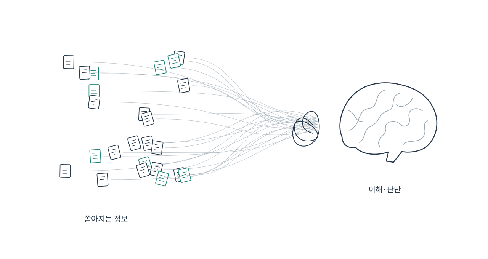
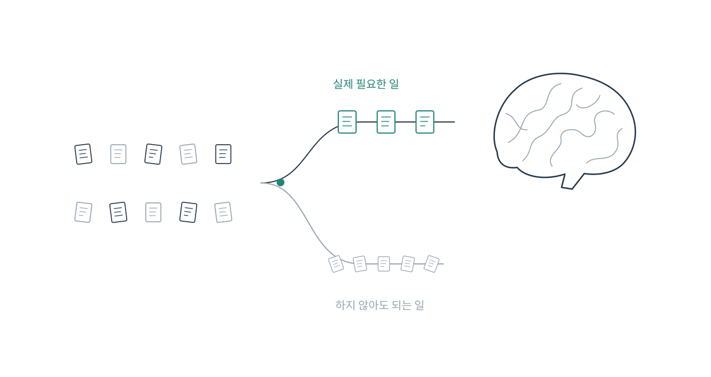
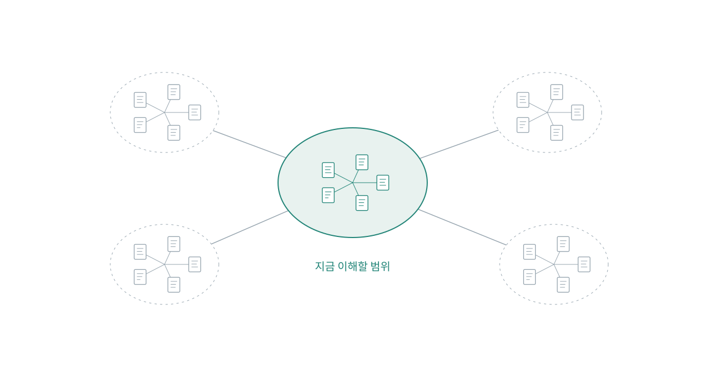
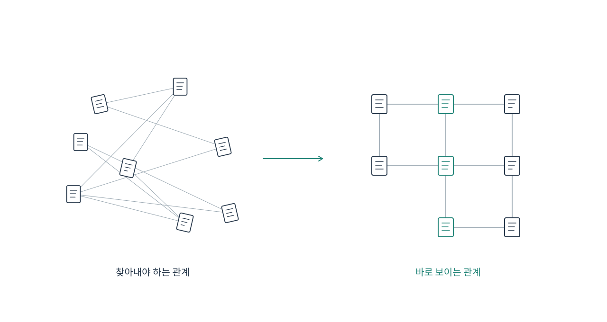
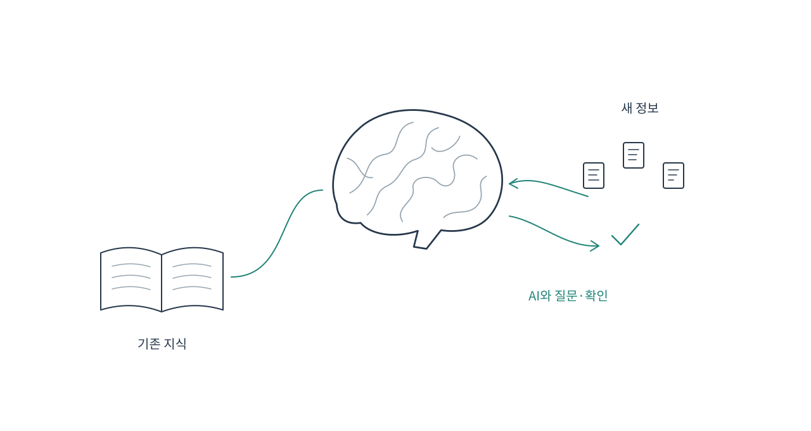
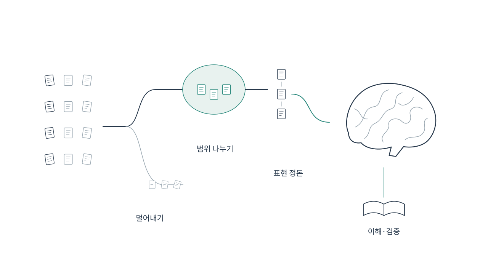

이 글은 저자 본인이 작성했으며, 이미지는 AI를 활용해 제작했습니다.

AI를 활용하면 코드와 문서를 작성하는 시간을 줄일 수 있습니다. 하지만 결과물을 빠르게 만들어냈다고 해서, 그것을 이해하고 검증하는 일까지 끝나는 것은 아닙니다. 여러 작업을 동시에 위임하면 확인해야 할 변경도 많아집니다. 코드를 직접 작성하는 부담은 줄었지만, 결과물을 이해하고 판단하는 부담은 오히려 커질 수 있습니다.

사람이 한 번에 처리할 수 있는 정보의 양에는 한계가 있습니다. 지금 필요한 정보를 잠시 유지하고 조작하는 작업 기억의 용량이 제한되어 있기 때문입니다. 여러 변수의 상태, 분기 조건, 정책 사이의 관계를 동시에 기억하며 코드를 읽다 보면 일부 조건을 놓치거나 앞서 읽은 내용을 다시 확인하게 됩니다. 익숙한 정보를 하나의 묶음으로 다룰 수 있는지에 따라서도 부담은 달라집니다. 따라서 더 많은 내용을 머릿속에 넣으려고 하기보다, 한 번에 기억하고 판단해야 할 범위를 줄이는 방식으로 일을 구성할 필요가 있습니다.[^sweller2019][^paas2020]

최근 개발자 커뮤니티에서도 AI가 코드를 얼마나 빠르게 만드는지뿐 아니라, 사람이 그 결과를 어떻게 이해하고 검토할 것인지에 대한 논의가 눈에 띕니다. 작성 속도가 빨라져도 이해와 검증이 따라가지 못하면, 그 과정이 전체 개발의 병목이 될 수 있습니다. 개별 작업의 속도뿐 아니라 사람이 정보를 처리하는 부담까지 고려해야 하는 이유입니다.

저 역시 이 문제에 관심을 가지고 공부하다가 인지 부하라는 개념을 접하게 되었습니다. 이를 바탕으로 그동안의 개발 경험을 돌아보니, 효과적이라고 느꼈던 방법들에는 공통점이 있었습니다. 요청받은 기능을 바로 구현하기보다 실제 문제를 먼저 확인하고, 변경할 때 함께 알아야 할 범위를 줄이고, 리뷰에 필요한 정보를 명확히 정리하는 방식이었습니다.

이번 글에서는 인지 부하가 무엇인지 살펴보고, 그동안의 경험에서 도움이 되었던 방법들을 이 관점에서 정리해보겠습니다. 개발 과정에서 구체적으로 어떻게 행동하면 불필요한 부담을 줄일 수 있는지에 초점을 맞추겠습니다.

## 인지 부하란 무엇인가



**인지 부하는 과제를 수행하거나 학습하는 과정에서 작업 기억에 가해지는 부담입니다.**[^paas2020] 작업 기억은 지금 처리하고 있는 정보를 잠시 유지하고 조작하는 인지 체계입니다. 코드를 읽으며 변수의 상태를 기억하고, 분기 조건을 따라가고, 다른 함수의 동작과 연결하는 과정도 여기에 해당합니다.

[[인지 부하 이론(Cognitive Load Theory)]]에서는 전통적으로 이를 세 가지로 구분해 설명합니다.

- **내재적 인지 부하**: 과제에서 함께 고려해야 하는 정보 요소와 그 상호작용 때문에 생기는 부담입니다. 같은 코드라도 해당 도메인에 익숙한 개발자와 처음 접하는 개발자가 느끼는 부담은 다릅니다.
- **외재적 인지 부하**: 불명확한 설명, 흩어진 정보, 불필요한 표현 등 때문에 추가로 발생하는 부담입니다. 변경 의도를 찾으려고 여러 문서와 코드를 오가는 상황을 생각할 수 있습니다.
- **본유적 인지 부하**: 새로운 내용을 이해하고 기존 지식과 연결하여 지식 구조를 만드는 데 투입하는 노력입니다. 학습과 이해에 필요한 인지 자원을 사용하는 과정입니다.

2019년 Sweller 등의 설명에서는 본유적 부하를 독립적인 세 번째 부하보다는 내재적 부하를 처리하는 데 쓰이는 자원으로 다룹니다. 이 관점에서 개발 과정의 목표는 **불필요하게 소모되는 인지 자원을 줄이고, 필요한 이해와 판단에 집중할 수 있도록 만드는 것**입니다.[^sweller2019][^paas2020]

이제 이 이론을 응용해, 지금까지의 개발 경험을 바탕으로 개발 과정에서 인지 부하를 줄일 수 있는 방법을 구체적으로 설명하겠습니다.

## 1. 먼저 불필요한 문제를 만들지 않습니다



복잡한 코드를 쉽게 읽도록 만드는 것도 중요하지만, 그보다 먼저 확인할 것이 있습니다. 그 코드를 꼭 만들어야 하는지입니다.

새로운 기능을 추가하면 구현 이후에도 정책을 설명하고, 테스트를 유지하고, 장애에 대응하고, 다른 기능과의 관계를 관리해야 합니다. 필요한 기능을 가려내는 일은 앞으로 이해하고 관리할 문제의 범위를 정하는 일이기도 합니다.

### 요청된 기능과 해결해야 할 문제를 구분합니다

예를 들어 고객이 “엘리베이터가 너무 느리다”고 말하는 상황을 생각해보겠습니다. 이를 바로 속도 개선 요청으로 받아들이면 더 빠른 설비나 운행 알고리즘을 검토하게 됩니다.

먼저 불만의 원인을 실제 수송 능력 부족, 기다리는 동안의 지루함, 도착 시각을 알 수 없는 불확실성으로 구분해 살펴봅니다. 기다리는 경험이 문제라면 거울이나 도착 안내처럼 작은 변화가 대안이 될 수 있습니다. 실제 수송 능력이 부족하다면 설비나 운행 방식의 개선에 집중합니다.

핵심은 **해결책을 확정하기 전에 문제가 발생한 상황과 원인을 확인하고, 이를 통해 실제로 필요한 일을 구분해내는 것**입니다.

개발 요청도 마찬가지입니다. “다운로드 버튼을 만들어주세요”라는 요청에는 이미 하나의 해결 방법이 들어 있습니다. 실제 필요는 데이터를 외부 시스템으로 옮기는 것일 수도 있고, 현재 화면에서 필요한 항목을 찾기 어려운 것일 수도 있습니다. 원인에 따라 적절한 해결 방법은 달라집니다.

### 구현을 시작하기 전에 네 가지를 정리합니다

1. **어떤 상황에서 문제가 발생했는가**
   누가 무엇을 하려다가 어떤 불편을 겪었는지 실제 사례를 확인합니다. 추측한 원인은 확인된 사실과 구분합니다.
2. **어떤 상태가 되면 해결됐다고 볼 것인가**
   “다운로드 기능을 만든다”가 아니라 “담당자가 필요한 데이터를 누락 없이 전달할 수 있다”처럼 결과를 정의합니다. 필요한 경우 시간, 오류, 반복 작업 등의 확인 기준을 함께 정합니다.
3. **반드시 지켜야 하는 조건은 무엇인가**
   기존 시스템과 정책을 확인합니다. 바꿀 수 없는 제약과 승인 후 바꿀 수 있는 정책, 단순히 기존부터 해오던 관행을 구분합니다.
4. **더 작은 해결 방법은 없는가**
   개발하지 않는 방법, 기존 기능을 활용하는 방법, 최소한으로 개발하는 방법을 비교합니다. 구현 비용뿐 아니라 이후의 운영·검증·변경 비용도 봅니다.

결정에 영향을 주는 불확실한 가정은 큰 구현에 들어가기 전에 작은 실험으로 확인합니다. 해결 방법을 비교할 때는 개발자뿐 아니라 운영자와 사용자의 반복 작업까지 함께 살펴보고, 전체 과정의 부담을 줄이는 방법을 선택합니다.

이 단계에서는 문제, 성공 기준, 제약, 선택한 방법과 이유를 짧게 정리합니다. 이렇게 남긴 기록은 이후 판단의 기준이 됩니다.

## 2. 한 번에 이해해야 하는 범위를 줄입니다



개발이 필요하다고 판단했다면, 다음에는 남은 문제를 어떻게 나눌지 생각해야 합니다.

코드를 나눌 때는 파일의 크기보다 각 부분의 책임과 연결 방식을 먼저 정합니다. 책임이 명확하고 공통 계약으로 연결되어 있으면, 하나를 수정할 때 해당 부분과 계약에 집중할 수 있습니다.

중요한 것은 **특정 작업을 할 때 함께 이해해야 하는 범위를 줄이는 것**입니다.

### 상품과 할인 정책을 분리하는 예시

최근 회사에서 실제로 다뤘던 사례를 바탕으로 설명하겠습니다. 이해를 돕기 위해 상품과 할인 정책의 관계를 단순화한 예시입니다.

상품마다 여러 할인 정책의 계산 로직이 직접 포함되어 있다면, 상품과 정책이 서로 강하게 연결됩니다. 상품이 추가될 때마다 여러 할인 규칙을 구현하고, 정책이 바뀔 때마다 여러 상품의 코드를 확인해야 합니다.

상품이 N종류이고 할인 정책이 M종류라면, 각 조합의 결합이 구현 곳곳에 반복되는 구조가 될 수 있습니다.

이때 [[추상화(Abstraction)]]와 [[관심사 분리 (Separation of Concerns)]]를 통해 책임을 나눌 수 있습니다.

- 상품은 가격 계산에 필요한 상품 정보를 제공합니다.
- 할인 정책은 자신의 적용 조건과 할인 계산을 담당합니다.
- 할인 계산기는 어떤 정책을 적용하고 어떻게 조합할지 담당합니다.

사용하는 쪽에서는 다음 정도의 계약으로 계산을 요청할 수 있습니다.

```text
가격 계산 입력 = 상품 정보 + 수량 + 고객 조건 + 기준 시각
계산 결과 = 최종 금액 + 적용한 할인 내역
```

상품 코드를 읽는 사람이 모든 할인 정책의 내부 구현까지 따라갈 필요는 없어집니다. 할인 계산을 변경하는 사람도 상품별 저장 방식이나 화면 구성을 함께 이해할 필요가 줄어듭니다.

공통 계약으로 상품과 할인 정책을 독립적으로 확장하는 구조에서는, 직접적인 구현 의존성을 N×M 형태에서 N+M에 가까운 형태로 정리할 수 있습니다. 상품 정보는 상품에, 상품별 예외를 포함한 할인 규칙은 정책에, 할인 중복과 적용 순서는 계산기에 모입니다. 각 책임이 명확해지면서 더 단순한 구조로 코드를 읽고 변경할 수 있습니다.

상품을 수정할 때는 상품과 공통 계약을, 할인 정책을 변경할 때는 해당 정책과 계산 규칙을 중심으로 살펴봅니다. 서로의 내부 구현을 한꺼번에 따라가는 대신, 지금 바꾸는 책임과 그 경계에 집중할 수 있습니다. 이렇게 한 번에 이해해야 하는 범위를 분리하면 변경과 검토의 기준도 명확해집니다.

### 변경 이유를 기준으로 경계를 만듭니다

구체적으로는 다음 순서로 정리할 수 있습니다.

1. 현재 코드에 섞여 있는 업무 규칙을 적습니다.
2. 같은 이유로 함께 바뀌는 규칙은 모으고, 독립적으로 바뀌는 규칙은 분리합니다.
3. 각 부분의 입력, 출력, 오류, 반드시 지켜야 하는 조건을 정의합니다.
4. 사용하는 쪽이 그 계약만으로 작업할 수 있는지 확인합니다.
5. 내부 구현을 바꿔도 유지되어야 하는 동작을 테스트로 남깁니다.

이 과정에서 새로운 도메인 개념을 정립하거나 [[리팩토링(Refactoring)]]을 적용할 수 있습니다. 새 개념의 이름과 설명에 실제 업무 규칙과 변경의 경계를 담으면, 팀이 같은 기준으로 구조를 이해하고 수정할 수 있습니다.

작업과 PR도 같은 기준으로 나눕니다. 할인 계산 구조를 정리하는 변경과 새로운 할인 정책을 추가하는 변경을 구분하면, 리뷰어는 각각 구조와 동작에 집중할 수 있습니다. 서로 의존하는 PR이라면 선후 관계와 전체 목표를 함께 남겨야 합니다.

확인할 질문은 간단합니다.

> 이 부분을 수정할 때, 어디까지 이해하면 되는가?

## 3. 판단에 필요한 정보를 명확히 표현합니다



구조가 잘 나뉘어 있어도 표현이 불명확하면 이해하는 데 시간이 걸립니다. 변수 이름의 의미를 추측하거나, 변경 이유를 찾아 대화 기록을 읽거나, 긴 PR 본문에서 중요한 예외를 골라내야 할 수 있습니다.

이 단계에서는 필요한 정보를 쉽게 찾고 연결할 수 있도록 만드는 것이 중요합니다.

### 코드는 팀이 사용하는 개념으로 표현합니다

코드에서 쓰는 이름이 기획서나 대화에서 쓰는 용어와 다르면, 읽는 사람은 두 표현을 계속 번역해야 합니다. [[유비쿼터스 언어(Ubiquitous Language)]]를 정리하고 코드에도 같은 용어를 사용하면 이 부담을 줄일 수 있습니다.

할인 계산의 경우에도 `process`, `handle`, `data` 같은 이름만으로는 역할을 알기 어렵습니다. 어떤 정책을 선택하고, 어떤 순서로 계산하고, 무엇을 반환하는지가 흐름에서 드러나면 이해하기 쉽습니다.

예를 들어 다음은 가상의 할인 정책을 설명하는 의사코드입니다.

```text
적용 후보 = 현재 조건에 맞는 할인 정책 조회
적용 정책 = 중복 적용 규칙과 우선순위에 따라 선택
할인 결과 = 선택한 정책으로 금액 계산
최종 금액과 적용 내역 반환
```

상위 흐름에서는 무엇을 하는지 이해하고, 세부 규칙을 확인할 때 해당 구현으로 내려갈 수 있습니다. 정책의 적용 순서와 중요한 예외는 흐름이나 계약에서 드러내고, 세부 계산은 해당 구현에서 확인하도록 구성합니다.

선언형 코드나 계층형 아키텍처도 팀이 공유하는 표현과 관례를 바탕으로 적용합니다. 단순한 처리는 간결하게 유지하고, 여러 규칙을 구분해야 하는 부분에 필요한 계층을 두면 읽는 사람이 전체 흐름과 세부 동작을 나누어 이해할 수 있습니다.

### PR 본문은 판단하는 순서로 작성합니다

AI로 PR 본문을 작성하면 변경된 내용을 빠르게 정리할 수 있습니다. 파일별 수정 목록을 변경의 목적과 영향 중심으로 재구성하면 리뷰어가 판단하기 쉬운 본문이 됩니다.

리뷰어가 알고 싶은 내용부터 다음 순서로 정리합니다.

1. **왜 바꾸는가**: 기존에 어떤 문제가 있었는가.
2. **무엇이 달라지는가**: 변경 전후의 동작이나 구조가 어떻게 다른가.
3. **영향과 예외는 무엇인가**: 어디까지 영향을 주며, 무엇은 바꾸지 않았는가.
4. **어떻게 확인했는가**: 어떤 검사로 확인했고, 무엇은 확인하지 못했는가.

앞의 할인 사례는 다음 형식으로 정리할 수 있습니다. 각 항목에는 실제 변경 내용과 확인한 테스트 결과를 담습니다.

```text
이유
상품별 코드에 할인 계산이 중복되어 정책 변경 시 수정이 누락될 수 있다.

변경
할인 계산을 공통 계산기로 옮긴다.
이번 변경에서는 할인율과 중복 적용 규칙을 바꾸지 않는다.

영향
상품별 호출부가 변경된다.
금액 반올림과 정책 적용 순서가 기존과 같은지 중점적으로 확인한다.

검증
변경 전후 결과를 비교한 테스트와 실행 결과를 연결한다.
확인하지 못한 조합이나 환경은 별도로 적는다.
```

복잡한 흐름은 짧은 의사코드로, 여러 구성 요소의 관계는 그림으로 보여줄 수 있습니다. 그리고 근거가 되는 코드와 테스트를 가까이 연결합니다. 같은 설명을 긴 문장, 그림, 코드로 반복하기보다는 각 표현이 필요한 정보를 보완하도록 구성합니다.

본문의 길이가 짧은지는 부차적인 문제입니다. **리뷰어가 변경 이유, 동작 차이, 위험, 검증 결과를 다시 찾아다니지 않고 판단할 수 있는지**가 더 중요한 기준입니다.

## 4. AI는 사전 지식에 맞춰 이해를 돕는 도구로 사용합니다



같은 설명으로 모든 사람이 같은 수준의 이해에 도달하지는 않습니다. 어떤 개발자는 도메인 정책을 알고 있지만 프레임워크에 익숙하지 않을 수 있고, 다른 개발자는 그 반대일 수 있습니다.

이때 AI와의 대화는 필요한 설명을 자신의 지식에 맞춰 보완하는 방법이 될 수 있습니다. 제가 일하는 환경에서도 AI 코드 리뷰에 질문을 남기면 코드와 MR의 맥락을 바탕으로 설명을 받을 수 있습니다.

AI에 코드를 설명해달라고 요청할 때는 모르는 지점을 구체적으로 질문합니다.

- 이 조건을 제거하면 어떤 사례에서 결과가 달라지는가?
- 이 규칙은 어느 코드와 테스트에서 확인할 수 있는가?
- 내가 이해한 동작과 실제 구현이 다른 부분은 무엇인가?

중요한 내용은 답변에 연결된 코드와 테스트로 확인합니다. 변경분만으로 판단할 수 없는 정책이나 주변 구현도 함께 살펴봐야 합니다. 회사 코드를 다른 도구에서 다룬다면 회사의 보안 및 도구 사용 정책을 먼저 따라야 합니다.

이 과정의 목표는 왜 해당 조건이 필요하고, 어떤 경우에 실패하며, 무엇을 확인해야 하는지 스스로 설명할 수 있도록 이해를 쌓는 것입니다.

## 결론



인지 부하를 낮추는 개발 방법은 문제를 받아들이는 방식부터 설계, 코드, 리뷰까지 이어집니다. 각 단계에서 이해하고 판단할 범위를 명확히 정리하는 것이 핵심입니다.

- **개발하기 전에**: 요청이 나온 경위를 확인하고, 더 작은 해결 방법이 있는지 비교합니다.
- **설계하고 구현할 때**: 변경 이유에 따라 책임을 나누고, 계약을 통해 한 번에 알아야 할 범위를 줄입니다.
- **검토를 요청할 때**: 변경 이유와 동작 차이, 위험, 검증 근거를 판단하기 쉬운 순서로 표현합니다.
- **이해가 부족할 때**: AI와 대화하며 설명을 보완하고, 코드와 테스트를 통해 이해를 확인합니다.

문제 정의, 관심사 분리, 명확한 명명, 작은 PR은 개발 과정에서 익숙하게 활용해 온 실천입니다. 인지 부하라는 관점은 이런 실천을 하나의 질문으로 연결해 줍니다.

**지금 이 일을 이해하고 판단하기 위해, 사람이 불필요하게 붙잡고 있어야 하는 정보는 무엇인가?**

그 정보를 줄이고 필요한 근거를 명확히 남기는 것이, 더 적은 부담으로 개발의 품질을 지키기 위한 출발점입니다.

## 참고 자료

[^sweller2019]: Sweller, J., van Merriënboer, J. J. G., & Paas, F. (2019). [Cognitive Architecture and Instructional Design: 20 Years Later](https://doi.org/10.1007/s10648-019-09465-5).
[^paas2020]: Paas, F., & van Merriënboer, J. J. G. (2020). [Cognitive-Load Theory: Methods to Manage Working Memory Load in the Learning of Complex Tasks](https://journals.sagepub.com/doi/full/10.1177/0963721420922183).
